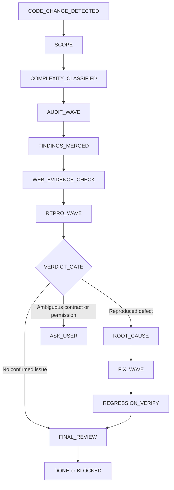

# Crucible

Crucible là bộ kiểm tra end-to-end cho function hoặc workflow vừa thay đổi. Nó không chỉ tìm lỗi bằng static inspection: Crucible xác định scope, phân tích failure scenarios, xác minh giả định bên ngoài, chạy reproduction probe trên code thật, chỉ sửa lỗi đã được chứng minh, rồi review lại consistency, scope và test proof.

`SKILL.md` là entrypoint duy nhất được OMP discovery nạp. Các file `.md` cùng thư mục là reference theo từng phase; không phải managed skill độc lập.

## Khi nào dùng

Dùng Crucible khi:

- Một lượt chỉnh sửa code vừa settle và cần kiểm tra end-to-end.
- Một function, method hoặc workflow có rủi ro về concurrency, state, network, auth, resource collision hoặc data integrity.
- Cần phân biệt lỗi thật với hypothesis, fixture lỗi hoặc assumption chưa được xác minh.
- Cần reproduction probe trước khi quyết định sửa code.
- Cần một final review độc lập trước khi khai báo hoàn tất.

Không dùng Crucible để:

- Audit docs-only hoặc test-only changes.
- Đoán target khi diff, caller hoặc contract chưa xác định.
- Thay thế test suite thông thường bằng một probe tùy tiện.
- Chạm live config, credential, deployment, account hoặc resource thật nếu chưa có quyền rõ ràng.

## Cấu trúc thư mục

```text
omp/agent/managed-skills/crucible/
├── SKILL.md       # OMP entrypoint và master router
├── README.md      # Tài liệu vận hành chi tiết này
├── scope.md       # Scope, callers, boundaries, invariants, complexity
├── stress.md      # Failure scenarios và falsification worker
├── evidence.md    # Xác minh API/runtime/protocol bằng nguồn chính thống
├── repro.md       # Probe gọi production symbol, watchdog, oracle, cleanup
├── patch.md       # Root-cause fix tối thiểu và regression test
└── review.md      # Final review: consistency, scope, verification
```

| File | Trách nhiệm | Được phép sửa production code? |
|---|---|---:|
| `SKILL.md` | Điều phối state machine và chọn phase | Không, trừ khi đi qua `patch.md` |
| `scope.md` | Xác định target và boundary | Không |
| `stress.md` | Phân tích failure mode và phản biện hypothesis | Không |
| `evidence.md` | Kiểm tra assumption bên ngoài | Không |
| `repro.md` | Chạy probe cô lập trên code thật | Không |
| `patch.md` | Sửa root cause đã đủ bằng chứng | Có, trong scope được phép |
| `review.md` | Review cuối và xác nhận test proof | Không |

## Cách kích hoạt

### Tự động sau code turn

Extension `omp/agent/extensions/autonomous-function-audit.ts` đăng ký theo dõi kết quả thành công của tool `edit` và `write`. Khi session chính settle, idle và pending set có code file, extension tạo checkpoint rồi gửi continuation context dưới đây. Đây là điều kiện kích hoạt trong code, không phải bảo đảm mọi lần sửa đều được ghi nhận; xem mục **Giới hạn triển khai hiện tại**.

```text
Run crucible now.
auditRunId=<run-id>
auditContinuation=true
changedFiles=["path/to/changed-file.ts"]
Inspect the saved checkpoint before spawning workers.
Do not touch live systems, secrets, deployment, or unrelated user changes.
```

Extension bỏ qua:

- tool result bị lỗi;
- tool khác `edit` hoặc `write`;
- file test, docs, config, lockfile và skill definition;
- `session_stop` của subagent (không đồng nghĩa tool result đã được cô lập theo session);
- session đang bận;
- session stop đã có recursion guard;
- fingerprint đã được xử lý trong session.

### Kích hoạt thủ công

Dùng command:

```text
/crucible
```

`/autonomous-audit` vẫn là alias tương thích. Cả hai command đều từ chối khởi động khi agent đang bận và gửi yêu cầu chạy Crucible khi agent idle.

### Cài đặt — dành cho người vận hành

Chỉ thực hiện khi chủ động triển khai vào runtime. Các lệnh dưới đây chạy từ repository root, dùng shell Bash/POSIX; không phải PowerShell. Nếu runtime đã có file cùng tên, sao lưu và kiểm tra divergence trước khi ghi đè.

```bash
mkdir -p "$HOME/.omp/agent/extensions" "$HOME/.omp/agent/managed-skills"
cp omp/agent/extensions/autonomous-function-audit.ts "$HOME/.omp/agent/extensions/"
cp omp/agent/extensions/autonomous-function-audit-state.ts "$HOME/.omp/agent/extensions/"
cp -R omp/agent/managed-skills/crucible "$HOME/.omp/agent/managed-skills/"
```

Trên Windows PowerShell, copy nguyên folder và hai extension tương ứng:

```powershell
$extensions = Join-Path $HOME '.omp/agent/extensions'
$skills = Join-Path $HOME '.omp/agent/managed-skills'
New-Item -ItemType Directory -Force -Path $extensions, $skills | Out-Null
Copy-Item 'omp/agent/extensions/autonomous-function-audit.ts' $extensions
Copy-Item 'omp/agent/extensions/autonomous-function-audit-state.ts' $extensions
Copy-Item 'omp/agent/managed-skills/crucible' $skills -Recurse -Force
```

Các lệnh này dùng đường dẫn discovery theo user và có thể làm skill xuất hiện ở project khác. Nếu cần project isolation, không chạy recipe cài global; giữ bundle trong project và dùng cơ chế nạp skill theo project đã được xác minh cho runtime đang dùng. README không cung cấp config key hay installer mới.

### Cấu hình và sử dụng — dành cho người vận hành

Khởi động lại OMP sau khi triển khai. Dùng `/crucible` trong session idle; không phải lệnh shell `omp crucible`. Command hiện tại không đọc argument, vì vậy nêu target và quyền phân tích/repro/fix trong hội thoại trước khi gọi. Không cần thay model, fallback, credential hoặc config để dùng bundle này.

### Hướng dẫn dành cho automated agent

Đọc [SKILL.md](SKILL.md), rồi chỉ đọc reference của phase cần chạy. Resolve path reference từ thư mục chứa `SKILL.md`, không từ working directory của target project. Handoff cho subagent phải có đường dẫn reference đầy đủ, target, scope, invariant và quyền hiện tại; đọc README không đồng nghĩa phải nạp toàn bộ bundle.

Không tự copy vào live `~/.omp`, cài dependency hoặc sửa config khi chỉ được yêu cầu nghiên cứu. Nếu user đã yêu cầu triển khai, dùng deployment path hiện có, bảo toàn divergence và kiểm tra runtime sau restart. Chỉ có skill không tự đăng ký `/crucible`; command và auto-trigger thuộc extension.

## Luồng xử lý



### 1. `SCOPE`

Đọc diff, file thay đổi, callers và downstream consumers. Ghi rõ:

- `targetSymbols`
- `callers`
- `boundaries`
- `invariants`
- `riskDimensions`
- `changedFiles`
- `excludedScope`
- `complexity`
- `openQuestions`

Nếu không xác định được target hoặc invariants mâu thuẫn với product intent, dừng và hỏi user. Không tự chọn một target “có vẻ đúng”.

### 2. `COMPLEXITY_CLASSIFIED`

Chọn worker budget theo surface thật:

| Mức | Điều kiện | Worker guidance |
|---|---|---:|
| `small` | Pure logic, ít boundary | 1–2 hoặc xử lý inline |
| `medium` | Async hoặc external dependency | 3–5 |
| `high` | Stateful hoặc concurrent workflow | 5–8 + falsification |
| `distributed` | Multi-node, multi-router hoặc security-sensitive | 8–10 + falsification + evidence |

Không tạo worker giả chỉ để đạt số lượng.

### 3. `AUDIT_WAVE`

Theo `stress.md`, chia các worker `agent: "scout"` thành slice không chồng lấn:

- Network & Transport
- Authentication & Session
- Concurrency & Deadlock
- State Consistency & Drift
- Data Validation & Parsing
- Resource & Collision

Wave từ 3 worker trở lên bắt buộc có ít nhất một falsification worker. Worker này phải cố chứng minh hypothesis không xảy ra, không chỉ lặp lại claim ban đầu.

Mỗi finding phải có `findingId`, `category`, `claim`, `trigger`, `executionFlow`, `codeEvidence`, `invariant`, `impact`, `severity`, `confidence`, `falsificationExperiment` và `assumptions`.

### 4. `FINDINGS_MERGED`

Coordinator phải:

1. Gộp các finding trùng root cause.
2. Tách symptom khỏi invariant bị vi phạm.
3. Đánh dấu assumption phụ thuộc runtime, library, protocol hoặc environment.
4. Không nâng `hypothesis` thành `confirmed` chỉ vì nhiều worker cùng suy đoán.

### 5. `WEB_EVIDENCE_CHECK`

Chỉ gọi `evidence.md` khi finding phụ thuộc claim bên ngoài. Ưu tiên:

1. Official vendor documentation.
2. Upstream source và test suite.
3. RFC hoặc upstream issue/PR.
4. Blog, forum và Q&A chỉ làm lead.

Evidence xác minh behavior có được documented, possible hoặc standard hay không. Evidence không thay thế local reproduction và không đủ để tự nâng finding thành `confirmed`.

### 6. `REPRO_WAVE`

Theo `repro.md`, worker `agent: "task"` phải gọi trực tiếp production symbol. Probe phải có:

1. Preconditions và clean fixture.
2. Healthy baseline.
3. Fault injection tối thiểu tại external boundary.
4. Watchdog giới hạn thời gian.
5. Oracle kiểm tra invariant observable.
6. `finally` cleanup cho socket, listener, timer, server và DB handle.

Probe toy không gọi target thật là `harness-error`, không phải bằng chứng cho bug.

### 7. `VERDICT_GATE`

| Verdict | Hành động |
|---|---|
| Không có issue được xác nhận | Bỏ qua patch, chuyển `FINAL_REVIEW` |
| `reproduced` với root cause rõ | Chuyển `ROOT_CAUSE` rồi `FIX_WAVE` |
| `not-reproduced` | Không sửa; ghi lại observation và giới hạn probe |
| `inconclusive` | Không sửa; ghi rõ gap hoặc chạy probe được phép khác |
| `harness-error` | Sửa fixture/probe, không kết luận target lỗi |
| Contract, target hoặc permission mơ hồ | `ASK_USER` |

### 8. `FIX_WAVE` và `REGRESSION_VERIFY`

`patch.md` chỉ cho phép patch khi:

- Probe có verdict `reproduced`; hoặc
- User explicitly authorize fix dựa trên static evidence.

Patch phải:

- nêu một causal hypothesis;
- trace symptom về trigger line;
- thay đổi tối thiểu;
- không kèm speculative refactor, retry loop hoặc abstraction ngoài yêu cầu;
- chuyển probe thành regression test phù hợp convention;
- chạy lại reproduction và full affected module suite.

### 9. `FINAL_REVIEW`

Theo `review.md`, reviewer độc lập kiểm tra ba gate:

- **Consistency**: mọi caller, duplicate pattern, export và re-export liên quan đã được cập nhật.
- **Scope**: không có file, user change hoặc behavior ngoài boundary bị chạm.
- **Verification**: đã chạy full affected test module và exercise runtime path thật; raw output được giữ lại.

Kết quả review dùng `approved`, `changes-requested` hoặc `blocked`.

## Checkpoint và idempotency

Extension lưu audit run bằng custom entry `autonomous_audit_run`. Run chứa session, fingerprint, changed files và phase ban đầu `SCOPE`. Fingerprint là 16 ký tự hex đầu của SHA-256 trên danh sách đường dẫn đã sort và nối bằng `|`; không hash nội dung hay diff. Việc lowercase và đổi separator chỉ phục vụ lọc loại file, không normalize đường dẫn trước khi hash.

Khi session stop lặp lại cùng fingerprint:

- không tạo run thứ hai;
- không gửi continuation thứ hai;
- pending file state được clear theo lifecycle hiện tại.

Khi `session_shutdown` hoặc `session_switch` xảy ra, pending state được clear. Audit continuation phải đọc checkpoint trước khi dispatch worker để không lặp phase đã hoàn tất.

### Giới hạn triển khai hiện tại

- Pending set chỉ được tạo khi `session_stop` đi tới bước lấy file của session. `tool_result` chỉ thêm path vào các set đã tồn tại. Vì vậy lần sửa trước lần stop đó có thể không được ghi nhận; set còn bị xóa sau khi trigger. Auto-trigger không thay thế việc gọi thủ công khi cần kiểm tra chắc chắn.
- Tool result được thêm vào mọi pending set đang có, không được gắn riêng với session phát sinh. Không coi pending set là bằng chứng session isolation.
- Fingerprint theo tên file có thể chặn lần sửa nội dung mới trên cùng tập file; ngược lại cách viết separator khác có thể tạo fingerprint khác. Đây không phải content-based deduplication.
- Extension hiện chỉ append checkpoint khởi tạo. State helper có field artifact/verdict nhưng chưa có workflow tự ghi tiến độ từng phase hay command resume. Yêu cầu đọc checkpoint trong skill là hướng dẫn điều phối, không chứng minh crash-resume đã được triển khai.
- Command thủ công chỉ gửi `Run crucible now.`; không tạo `auditRunId`, truyền `changedFiles` hoặc chọn target từ argument. Report thủ công phải ghi run ID không được cấp, không bịa ID từ extension.
- State machine là hướng dẫn cho agent, không phải engine runtime enforce quyền, schema hay chuyển trạng thái. Host rules và quyền user vẫn là ràng buộc quyết định.

Các giới hạn này được ghi nhận từ implementation; README không sửa chúng.

## Report contract

Final report trình bày findings đã xác nhận trước likely/hypothetical findings và gap. Mẫu dưới minh họa các trường, không phải schema được runtime validate. Với phase chưa chạy, ghi `NOT RUN` cùng lý do; không bịa command, kết quả hay `auditRunId` cho invocation thủ công.

```yaml
auditRunId: <string>
targetSymbols: [<string>]
complexity: small|medium|high|distributed
findings:
  - id: <string>
    category: <string>
    confidence: confirmed|likely|hypothesis
    verdict: reproduced|not-reproduced|inconclusive|harness-error
reproduction:
  rawCommand: <command>
  runnerResult: PASS|FAIL|TIMEOUT
  watchdog: <limit>
fixVerification:
  regressionTest: <command or test path>
  affectedSuite: <command and result>
status: DONE|BLOCKED
```

`BLOCKED` phải nêu blocker cụ thể: thiếu permission, live resource không được phép truy cập, destructive action cần approval, contract chưa rõ hoặc fixture chưa đủ.

## Guardrails

Crucible phải dừng thay vì đoán trong các trường hợp sau:

- target symbol hoặc contract không rõ;
- invariants mâu thuẫn với user intent;
- cần truy cập live account, deployment, database hoặc router;
- cần ghi credential hoặc live config;
- probe không gọi code thật;
- finding chỉ có static speculation nhưng patch chưa được authorize;
- worker report không có code evidence hoặc execution evidence tương ứng;
- test suite có failure nhưng chưa phân biệt failure mới với failure có sẵn.

### Rationalizations bị từ chối

| Rationalization | Quy tắc Crucible |
|---|---|
| “Bug hiển nhiên, không cần repro.” | Hypothesis chưa được reproduce không phải confirmed bug. |
| “Mock bị treo nên production bị deadlock.” | Mock stall chỉ chứng minh harness behavior trong observation window. |
| “Patch nhỏ nên bỏ qua full suite.” | Luôn chạy full affected module suite. |
| “Contract hơi mơ hồ, chọn default hợp lý.” | Dừng và hỏi user. |
| “Nhiều worker cùng nói vậy nên chắc chắn.” | Merge duplicate, rồi vẫn cần decisive evidence. |

## Ví dụ sử dụng

### Chỉ phân tích, chưa cho phép sửa

Yêu cầu mẫu: “Dùng Crucible kiểm tra `rotateAccount` trong `src/rotation.ts`; chỉ phân tích concurrency, chưa chạy repro hay sửa code.”

Router đọc `scope.md` và `stress.md`, xác định invariant về quyền sở hữu resource, rồi trả finding kèm trigger và code evidence. Nếu claim phụ thuộc API bên ngoài, đọc `evidence.md`. Dừng ở báo cáo trong quyền được cấp; không tự coi lời gọi Crucible là quyền sửa.

### Reproduce rồi sửa trong fixture cô lập

Yêu cầu mẫu: “Kiểm tra `rotateAccount`; được chạy probe local và sửa lỗi tái hiện được, không chạm account hoặc router live.”

Probe gọi production symbol với hai invocation đồng thời, mock external boundary và assert invariant đã xác định từ contract. `reproduced` mới mở patch gate; `harness-error` yêu cầu sửa fixture thay vì target. Sau patch, chạy regression cùng full affected module và runtime smoke, rồi review ba gate. Đây là kịch bản minh họa, không phải kết quả đã chạy.

## Verification

Từ repository root, chạy contract tests:

```bash
node --test scripts/managed-skills.test.mjs
```

Chạy deployment/documentation test:

```bash
node --test scripts/autonomous-audit-deployment.test.mjs
```

Chạy full suite:

```bash
node --test scripts/*.test.mjs search/tests/*.test.mjs
```

Các test này kiểm tra entrypoint, reference modules, state-machine markers, README deployment contract và runtime extension behavior. Chúng không chứng minh live network, provider behavior hoặc native macOS compatibility.

## Troubleshooting

### Skill không xuất hiện trong OMP

Kiểm tra:

1. Đích cài theo user có đúng `$HOME/.omp/agent/managed-skills/crucible/SKILL.md` không; `omp/agent/managed-skills/crucible/` là đường dẫn source trong repository, không phải runtime root.
2. Frontmatter có `name: crucible` và `description` hợp lệ không.
3. OMP đã restart sau khi copy skill chưa.
4. Không copy các reference thành thư mục skill riêng; chỉ `crucible/SKILL.md` là entrypoint.

### Không tự động kích hoạt

Kiểm tra:

1. Extension đã được copy vào `$HOME/.omp/agent/extensions/` chưa.
2. Tool result có phải thành công từ `edit` hoặc `write` không.
3. Path có phải code file được hỗ trợ không.
4. Session có đang idle và là main agent không.
5. `stop_hook_active` hoặc duplicate fingerprint có chặn continuation không.

### Finding không được patch

Kiểm tra verdict. `likely`, `hypothesis`, `not-reproduced`, `inconclusive` và `harness-error` không đủ điều kiện cho patch tự động. Xem `repro.md`, chạy probe trên target symbol thật, hoặc xin user authorization nếu static fix là chủ đích.

### Test báo `harness-error`

Đây là lỗi fixture/probe, không phải verdict target. Kiểm tra target import, fixture setup, watchdog, cleanup và external boundary mock; không sửa production code để che lỗi harness.

## Liên quan

- Entry skill: [SKILL.md](SKILL.md)
- Scope contract: [scope.md](scope.md)
- Stress analysis: [stress.md](stress.md)
- External evidence: [evidence.md](evidence.md)
- Reproduction: [repro.md](repro.md)
- Root-cause patch: [patch.md](patch.md)
- Final review: [review.md](review.md)
- OMP lifecycle extension: [autonomous-function-audit.ts](../../extensions/autonomous-function-audit.ts)
- State persistence helper: [autonomous-function-audit-state.ts](../../extensions/autonomous-function-audit-state.ts)
