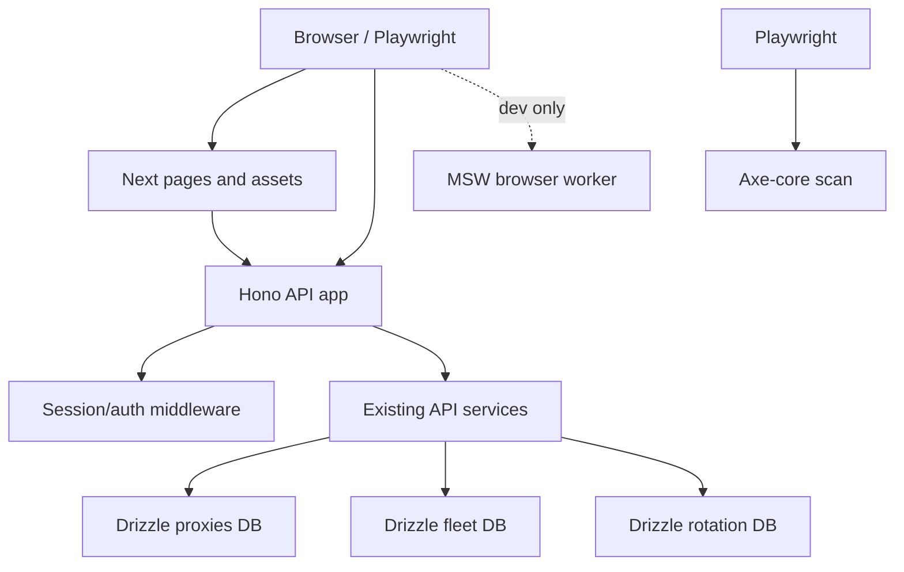

# Full-Stack Tooling Migration Design

**Status:** Architecture and written specification approved
**Date:** 2026-10-22
**Scope:** Replace the current API, database, linting, mocking, and accessibility foundations with Hono, Drizzle ORM, Biome, MSW, and Axe-core without changing product behavior.

## Goal

Migrate the project from native API dispatch, raw `node:sqlite` access, ESLint-only tooling, placeholder MSW setup, and import-only Axe smoke checks to the five requested tools while preserving all existing HTTP, authentication, database, scheduler, proxy, fleet, and UI behavior.

## Existing constraints

- Runtime is Node.js `>=22.0.0`.
- Frontend is Next.js `16.2.12` with React `19.2.8` and strict TypeScript.
- `src/server/server.ts` is a custom Node HTTP server that also hosts Next.js, scheduled maintenance, and upgrade/HMR handling.
- Runtime persistence uses three SQLite files through `node:sqlite` and `DatabaseSync`:
  - `proxies.sqlite3`
  - `fleet.sqlite3`
  - `antigravity-rotation.sqlite3`
- Existing migrations include legacy-column checks, WAL mode, foreign keys, retry behavior, and explicit transactions.
- Session authentication is in-memory and process-local. The session cookie is `minhmiceproxy-session`; Basic, Bearer, and legacy-cookie compatibility must remain unchanged.
- Existing API callers live primarily in `src/lib/api.ts` and `src/lib/proxy-intelligence-api.ts`.
- Existing dashboard routes are under `src/app/(dashboard)` and include the route matrix listed in the Axe section.
- The current repository uses double-quoted TypeScript strings. Broad style-only rewrites are not acceptable.

## Decisions

### D1. One server process

The application keeps one Node HTTP server and one port. Hono is mounted inside the existing server. No second listener, port, process, or proxy is introduced.

Static installer and binary routes remain native. Next pages, assets, and HMR remain handled by Next. All `/api/*` requests are owned by Hono at completion.

### D2. Stable Drizzle with `better-sqlite3`

Use the stable `drizzle-orm/better-sqlite3` driver. Do not use the Drizzle `1.0` release candidate and do not import `drizzle-orm/node-sqlite`; stable `drizzle-orm@0.45.4` does not export that subpath.

The existing `node:sqlite` connections are replaced with `better-sqlite3` connections behind Drizzle database modules. This is a deliberate native dependency trade-off. The application must use the same three files under `APP_DATA_DIR`; it must not create `dev.db` or a second copy of production data.

### D3. Explicit database ownership

Drizzle becomes the only runtime database access layer. Prisma scaffolding, the unused Prisma schema/client, and the sample `src/db` database are removed after all callers are migrated. Drizzle Kit generates versioned migration files; the application does not run `drizzle-kit push` against live data.

Migration code may use Drizzle `sql` for SQLite pragmas and legacy-compatible DDL. Runtime reads and writes use typed Drizzle queries or transactions.

### D4. Hono owns API behavior, not product behavior

The existing API URL, method, status, response JSON, cookie attributes, auth compatibility, body limits, and error semantics are contracts. Hono replaces dispatch and centralizes middleware/error handling; it does not redesign those contracts.

### D5. Biome replaces ESLint after parity

Biome becomes the single repository lint/format command after its rules have been reconciled with the existing code. The migration preserves double quotes and avoids a repository-wide style churn. `eslint.config.mjs`, ESLint packages, and ESLint scripts are removed only after Biome passes on the complete intended scope.

### D6. MSW is development/test-only

MSW never runs in production. Browser mocking is opt-in in development. Node test mocking is explicit per test and fails on unhandled requests. Handlers model real frontend API contracts rather than the placeholder `api.example.com/health` endpoint.

### D7. Axe is a real authenticated browser gate

Axe runs against the built dashboard through Playwright, not against imports or synthetic HTML. The suite authenticates through the real API, scans every dashboard route, reports actionable violations, and fails CI for any remaining violation. No permanent rule suppression or severity waiver is introduced.

## Target architecture

### Server boundary

Create an API application factory that receives existing repositories and services as dependencies. The factory exposes the existing route namespaces:

- `/api/health`
- `/api/auth/*`
- `/api/fleet/*`
- `/api/ninerouter/*`
- `/api/antigravity/*`
- `/api/settings*`
- `/api/intelligence/*`
- `/api/proxies/*`

`src/server/server.ts` remains responsible for process startup, Next preparation, static routes, upgrade/HMR, scheduler startup, graceful shutdown, and dependency construction. It delegates `/api/*` to the Hono listener. The final native pathname dispatch must not retain a second implementation of an API route.

### API modules

Split Hono routes by existing domain rather than creating one large route file:

- `src/server/api/app.ts`: Hono app factory, shared `onError`, not-found response, dependency type.
- `src/server/api/middleware/auth.ts`: session and compatibility auth middleware.
- `src/server/api/routes/auth.ts`: login, logout, session.
- `src/server/api/routes/fleet.ts`: fleet runtime and fleet management routes.
- `src/server/api/routes/ninerouter.ts`: 9Router routes.
- `src/server/api/routes/antigravity.ts`: Antigravity routes.
- `src/server/api/routes/settings.ts`: settings and diagnostics routes.
- `src/server/api/routes/intelligence.ts`: proxy intelligence and audit routes.
- `src/server/api/routes/proxies.ts`: unified proxy routes.

Each module exports a registration function receiving the shared dependency object. Route modules must preserve current method/path guards and response payloads. Shared body parsing must enforce the current route-specific limits: 10,000 bytes for auth login, 1,000,000 bytes for general JSON, 5,000,000 bytes for intelligence import/preview, and 65,536 bytes for fleet agent runtime bodies.

### Database modules

Split schema and client definitions by database file:

- `src/db/proxies/schema.ts`, `src/db/proxies/client.ts`
- `src/db/fleet/schema.ts`, `src/db/fleet/client.ts`
- `src/db/rotation/schema.ts`, `src/db/rotation/client.ts`
- `src/db/migrations.ts` or domain-specific migration modules

Every client receives an absolute file path derived from `APP_DATA_DIR`. Each connection enables WAL and foreign keys, with the existing timeout/retry behavior preserved. Each repository owns its Drizzle database instance and closes it during shutdown.

Schema definitions must match the current tables, column names, nullability, defaults, primary keys, foreign keys, indexes, and legacy upgrade paths. A schema mismatch is a migration failure, not a reason to silently reset or recreate a database.

## Data migration and rollback

### Preflight

Before enabling the new runtime against any existing data directory:

1. Stop the application and background writers.
2. Open each existing database with its current connection layer.
3. Execute `VACUUM INTO` to create a consistent backup for each SQLite file. Do not use `copyFileSync` on a live WAL database.
4. Record file size, schema tables, `PRAGMA user_version`, row counts for every table, and WAL/foreign-key settings.
5. Run the new schema verifier against the backup copies.

The migration command must refuse to operate when the target database is live or when the backup/preflight checks fail.

### Baseline and forward migrations

- Create a baseline migration representing the current schema for each database.
- Mark the baseline as applied only after schema verification; never replay a destructive baseline on an existing database.
- Convert current inline legacy-column additions into explicit forward migrations with idempotent checks.
- Preserve existing data and IDs. No table drop, data truncation, implicit reset, or `drizzle-kit push` is allowed.
- Apply each migration in a transaction whenever SQLite permits it. Configure WAL, foreign keys, busy timeout, and lock retries in the database client bootstrap, not in generated migration SQL.
- Maintain one migration owner: Drizzle migration files plus the controlled startup migrator. Remove duplicate inline schema creation after the cutover.

### Rollback

Rollback is operational, not an automatic reverse migration. If verification fails:

1. Stop the new process.
2. Keep the failed database untouched for diagnosis.
3. Restore the preflight backup after confirming the old binary and old schema owner are available.
4. Re-run the old full test and acceptance suite.
5. Do not run a reverse migration that guesses how to restore user data.

The API/router cutover has a separate rollback switch: the old server revision is redeployed with the restored database. No runtime fallback between old and new handlers is retained in the final code.

### Data verification

The cutover must compare, for every database, table names, columns, indexes, foreign-key metadata, row counts, and representative domain records before and after opening through Drizzle. Repository tests must cover legacy schemas and transaction rollback, not only empty in-memory tables.

## Hono request and error flow

1. Native server handles installer and binary downloads.
2. Native server forwards `/api/*` to the Hono listener.
3. Hono applies route-specific body-limit and authentication middleware without adding new response headers or unrelated behavior.
4. Auth routes remain public where they are public today; protected routes use the compatibility auth middleware.
5. Route modules call existing services/repositories through injected dependencies.
6. A single error handler maps known errors to the existing status/body shape and prevents stack traces or credentials from reaching clients.
7. Unknown API routes return the existing JSON 404 shape.
8. Next handles all non-API requests.

Auth middleware must preserve session-cookie, Basic `admin:<password>`, Bearer password, and legacy-cookie behavior. Session creation and validation remain in the same process as the server. Tests must use the public login route or a same-process test factory; they must not create a session in a separate process and expect it to exist in the server.

## MSW design

### Handler sources

Handlers are generated from the actual client contracts and must cover every request discovered in `src/lib/api.ts`, `src/lib/proxy-intelligence-api.ts`, and any direct dashboard `fetch` call. The sample external health handler is removed.

Use typed fixtures for:

- auth session/login/logout
- health
- 9Router status, pools, sync, activation, update, deletion
- proxy intelligence list/detail/import/preview/jobs/cancel
- settings, diagnostics, and proxy export
- fleet and Antigravity requests when frontend callers use them

Provide explicit error handlers for expired session (`401`), quota exhaustion or unavailable fallback (`429`/`503`), validation (`400`), and server failure (`500`).

### Runtime setup

- `src/mocks/browser.ts` exports `setupWorker(...handlers)`.
- `src/mocks/node.ts` exports `setupServer(...handlers)`.
- `public/mockServiceWorker.js` is generated by the installed MSW version.
- Browser setup is dynamically imported only when a dedicated development flag is enabled and `window` exists.
- Browser unhandled requests use `bypass` so Next assets and HMR continue to work.
- Node tests use `onUnhandledFrame: "error"`, reset handlers after each test, and close the server in teardown.

MSW `3.0.3` uses `onUnhandledFrame` for both browser `worker.start` and Node `server.listen`; do not use the removed `onUnhandledRequest` option.

The mock flag must never activate mocking in a production build or production startup, even if supplied accidentally. Production startup must not import or start the browser worker.

## Biome design

Biome `2.6.2` is the pinned tool version through the lockfile. Configuration:

- VCS integration uses Git ignore rules.
- Formatter uses spaces, two-space indentation, double quotes, semicolons, and trailing commas consistent with the repository.
- Lint/format scope covers `src`, `tests`, `scripts`, and relevant TypeScript/MJS config files while ignoring generated/build/data artifacts.
- Rules are explicitly reviewed against current code; no blanket disable for the recommended preset.
- `biome check` is the required check command; `biome format --write` is limited to files in the migration commit or explicitly selected files.

Replace the ESLint script with Biome after the full scope passes. Remove ESLint configuration and packages only after grep confirms no remaining ESLint command, config reference, editor reference, or CI reference.

## Axe design

Create a Playwright accessibility suite with an isolated server/data directory and test credentials. Start the real app on a test port, wait for a health endpoint, log in through `/api/auth/login`, and reuse the resulting cookie in a browser context.

Scan these routes:

- `/`
- `/proxies`
- `/proxy-endpoints`
- `/nodes`
- `/monitoring`
- `/events`
- `/settings`
- `/wallet`
- `/reseller`
- `/referral`
- `/invoice`
- `/cdk`
- `/scraping`
- `/help`

Use `@axe-core/playwright` with WCAG 2.0 and 2.1 A/AA tags. Wait for the page's loading state and required data request completion before scanning. Report rule ID, impact, help URL, target, HTML, and failure summary. Any violation within those tags fails the test. Do not exclude third-party components, portals, or hidden nodes merely to pass; fix the markup or state producing the violation. Automated scans do not establish complete WCAG compliance, and Axe does not guarantee an SEO score.

Always close pages, contexts, browser, and the test server in `finally` blocks. CI must install the required Chromium browser and must not reuse the developer's running server or production data.

## Testing and acceptance

### Required regression checks

- Existing API contract tests continue to pass unchanged.
- Existing database migration, lifecycle, fleet, proxy, rotation, and auth test modules continue to pass.
- Every API route has at least one method/path/auth/error test after Hono migration.
- Every repository has fresh-data, existing-data, legacy-schema, transaction-rollback, and close/shutdown coverage.
- MSW Node tests prove handled requests, unhandled-request failure, handler reset, and error fixtures.
- MSW browser smoke test proves the real frontend client receives a fixture without changing its fetch code.
- MSW Node tests use `onUnhandledFrame: "error"`; browser development setup uses `onUnhandledFrame: "bypass"`.
- Axe scans the full route matrix against an isolated running app.
- Biome check and typecheck pass on the complete configured scope.
- Production startup test proves the frontend continues to use the real API and never starts MSW, including when the mock flag is mistakenly supplied. A static generated worker file may remain under `public`; its presence is not activation.

### Consistency checks before completion

1. Grep all old native API dispatch branches and confirm each route has exactly one Hono registration.
2. Grep all `DatabaseSync`, direct SQL repository calls, Prisma imports, `better-sqlite3` sample clients, `eslint`, and old Biome scripts; each remaining match must be an intentional migration adapter, test fixture, or documented generated artifact.
3. Grep all frontend API callers and compare them with MSW handlers and Hono route registrations.
4. Compare response status/body/cookie contracts against existing API tests and the pre-migration smoke capture.
5. Run each affected full test module, then the complete suite. Do not claim success from only a flipped smoke test.

### Completion criteria

The migration is complete only when:

- Hono is the sole `/api/*` dispatcher.
- Drizzle is the sole runtime SQLite access layer and all three existing databases open without data loss.
- Prisma, sample `dev.db`, duplicate native query paths, and obsolete migration owners are removed.
- Biome is the sole lint/format tool and existing code style remains stable outside touched lines.
- MSW has real browser and Node setups with production disabled.
- Axe scans every listed dashboard route with zero violations within the selected tags.
- Full typecheck, Biome check, affected test modules, full test suite, build, and runtime smoke checks pass.
- No unrelated product behavior, public API contract, database data, or operational process changes occur.

## Explicit non-goals

- No new product features or API endpoints.
- No redesign of authentication or session storage.
- No database consolidation: the three SQLite files remain separate.
- No adoption of the Drizzle release candidate.
- No Next.js App Router rewrite.
- No automatic data-destructive rollback or live database copying.
- No permanent test mocks in production.
