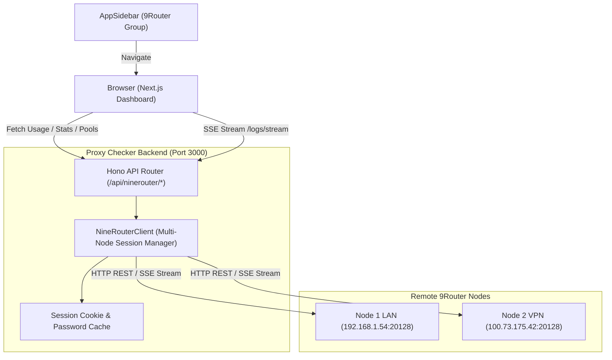

# Design Specification: 9Router Modifier Subsystem

**Document ID**: `2026-10-23-ninerouter-modifier-subsystem`  
**Author**: Assistant & minhmice  
**Status**: Draft for User Review  
**Target Surfaces**:
1. App Sidebar Navigation (`src/components/app-sidebar.tsx`)
2. 9Router Modifier Dashboard (`src/app/(dashboard)/ninerouter/dashboard/page.tsx`)
3. 9Router Modifier Proxies & Bindings (`src/app/(dashboard)/ninerouter/proxies/page.tsx`)
4. Backend API Routes (`src/server/api/routes/ninerouter.ts`, `src/server/nine-router-client.ts`)

---

## 1. Executive Summary & Goals

Xây dựng hệ thống giao diện và API tích hợp riêng cho **9Router Modifier** trực tiếp trong dashboard của `proxy-checker`:
1. **Sidebar Navigation**: Thêm nhóm menu riêng biệt `9ROUTER MODIFIER` bao gồm:
   - `Dashboard` -> `/ninerouter/dashboard`
   - `Proxies & Bindings` -> `/ninerouter/proxies`
2. **Dashboard Page (`/ninerouter/dashboard`)**:
   - **Tầng trên (Side-by-Side 2 cột)**: 2 Dashboard Usage tối giản cho 2 node 9Router (Node 1 LAN `192.168.1.54:20128` và Node 2 VPN `100.73.175.42:20128`).
     - Mỗi card hiển thị: Total Requests, Total Input Tokens, Cached Tokens, Output Tokens, Est. Cost, sparkline trend và model distribution.
   - **Tầng dưới (Side-by-Side 2 cột)**: 2 Live Console Log Terminals stream real-time qua SSE (`/api/translator/console-logs/stream`), định dạng màu sắc terminal chuẩn của 9Router với nút Clear, Pause/Resume, Auto-scroll và bộ lọc tìm kiếm.
3. **Proxies & Bindings Page (`/ninerouter/proxies`)**:
   - **Cột trái (Antigravity Account Bindings)**: Danh sách email accounts từ 9Router (`/api/providers/client?provider=antigravity`), badge trạng thái OAuth, toggle On/Off, badge Proxy Pool ID đang bind (`Proxy #1`, `Proxy #3`...), nút Apply Proxy.
   - **Cột phải (Proxy Pools Management)**: Danh sách pool proxy (`/api/proxy-pools?includeUsage=true`), badge ID, URL proxy (socks5/http), toggle On/Off, nút Test ping latency (biểu tượng ống nghiệm), Edit tên, Delete, Batch Import và nút gán nhanh vào account đang chọn bên trái.
4. **Backend BFF Architecture (Hono Proxy)**:
   - Toàn bộ kết nối ra 2 node 9Router đều đi qua server proxy nội bộ của Proxy-checker để tự động xác thực session cookie/password, tránh CORS và bảo mật credential.

---

## 2. Architecture & Data Flow



---

## 3. Detailed Component & UI Design (Impeccable Craft)

### 3.1. Sidebar Navigation (`src/components/app-sidebar.tsx`)
- Thêm `NAV_NINEROUTER`:
  ```typescript
  const NAV_NINEROUTER = [
    { href: "/ninerouter/dashboard", label: "Dashboard", icon: BarChart3 },
    { href: "/ninerouter/proxies", label: "Proxies & Bindings", icon: Shuffle },
  ] as const;
  ```
- Nhóm tiêu đề: `9ROUTER MODIFIER` (với dot indicator màu cam đặc trưng của 9Router).

### 3.2. Dashboard Page (`src/app/(dashboard)/ninerouter/dashboard/page.tsx`)
- **Top Bar Controls**:
  - Chọn khoảng thời gian: `Today`, `24h`, `7d`, `30d`, `60d`, `All`.
  - Nút Refresh thủ công & Status badge kết nối của từng Node (Online/Offline, Ping ms).
- **Upper Section: 2 Usage Cards (Grid 2 Cột)**:
  - **Left Card: Master Node (192.168.1.54)**
    - 5 Metrics KPI Tiles tối giản:
      - Total Requests (e.g. `1,259`)
      - Input Tokens (e.g. `98.2M` - highlight màu đỏ nhạt như 9Router gốc)
      - Cached Tokens (e.g. `64.5M` - highlight màu xanh dương)
      - Output Tokens (e.g. `389K` - highlight màu xanh lá)
      - Est. Cost (e.g. `~$63.62` - highlight màu vàng gold)
    - Mini Provider / Model breakdown list:
      - `gemini-3.8-flash-high (antigravity)`
      - `gpt-6.1-sol (codex)`
      - `gemini-3.8-flash-low (antigravity)`
  - **Right Card: Tailscale Node (100.73.175.42)**
    - Cấu trúc 5 KPI Tiles và Model breakdown tương tự cho node thứ 2.
- **Lower Section: 2 Live Console Log Terminals (Grid 2 Cột)**:
  - Header mỗi terminal: Tên server + status badge `Streaming` (xanh nhấp nháy), nút `Auto-scroll: ON/OFF`, nút `Clear`, ô `Search filter`.
  - Terminal body: Nền đen `bg-black/95`, font monospace `font-mono text-xs`, render màu sắc ANSI / emoji log chuẩn từ 9Router (`DONE 7169ms`, `TTFT`, `POST ag/gemini...`). Tự động giữ lịch sử tối đa 1,000 dòng để chống tràn RAM trình duyệt.

### 3.3. Proxies & Bindings Page (`src/app/(dashboard)/ninerouter/proxies/page.tsx`)
- **Header Action Bar**:
  - Node Selector: Switch hoặc Tab để thao tác trên Node 1 LAN hoặc Node 2 VPN (hoặc đồng bộ cả 2).
  - Nút `Apply All Proxies` (phân phối tự động 1 account - 1 proxy), nút `Test All Pools`, nút `Batch Import`.
- **Left Column: Antigravity Connections Table (Chiếm 50% width)**:
  - Bảng danh sách email:
    - Checkbox chọn nhiều.
    - Cột 1: Email + icon Google / Antigravity + Badge status (`active` xanh lá, `disabled` xám).
    - Cột 2: Proxy Pool đang gán kèm số thứ tự (e.g. `Proxy #1 - 100.71.252.27:10001`).
    - Cột 3: Quick Action: Dropdown chọn nhanh Pool muốn gán hoặc nút ngắt kết nối proxy (`Unbind`).
    - Cột 4: Switch On/Off tài khoản.
- **Right Column: Proxy Pools Table (Chiếm 50% width)**:
  - Bảng danh sách Pool:
    - Checkbox chọn.
    - Cột 1: ID rank + Tên / Protocol URL (`socks5://...`, `http://...`).
    - Cột 2: Trạng thái (`active` / `inactive`), số account đang bound (`1 bound`, `3 bound`...).
    - Cột 3: Latency test result (ms hoặc `Failed`).
    - Cột 4: Actions: Switch On/Off pool, Icon ống nghiệm (Test ngay), Edit, Delete.
    - Cột 5: Nút "Assign to Selected Account" -> click phát gán ngay vào email đang được select ở bảng bên trái.

---

## 4. Backend Endpoints (BFF Proxy Layer)

Tất cả các API được mount dưới `/api/ninerouter/*`:

1. `GET /api/ninerouter/nodes`:
   - Trả về danh sách 2 nodes cấu hình từ `settings.json` / target inventory:
     - `node-lan`: `192.168.1.54:20128`
     - `node-vpn`: `100.73.175.42:20128`
2. `GET /api/ninerouter/nodes/:nodeId/stats?period=today`:
   - Proxy tới `http://<node-ip>:20128/api/usage/stats?period=...` với session auth tự động.
3. `GET /api/ninerouter/nodes/:nodeId/logs/stream`:
   - Proxy SSE EventStream tới `http://<node-ip>:20128/api/translator/console-logs/stream`.
4. `GET /api/ninerouter/nodes/:nodeId/proxy-pools`:
   - Lấy danh sách proxy pools kèm usage info.
5. `POST /api/ninerouter/nodes/:nodeId/proxy-pools/:id/test`:
   - Test kết nối của 1 pool trên node chỉ định.
6. `PUT /api/ninerouter/nodes/:nodeId/proxy-pools/:id`:
   - Bật/tắt hoặc cập nhật cấu hình proxy pool.
7. `GET /api/ninerouter/nodes/:nodeId/connections`:
   - Lấy danh sách Antigravity connections trên node.
8. `PUT /api/ninerouter/nodes/:nodeId/connections/:id/bind-pool`:
   - Gán `proxyPoolId` vào connection providerSpecificData của node đó.

---

## 5. Error Handling & Edge Cases

1. **Node Offline / Unreachable**:
   - Nếu 1 trong 2 node bị sập hoặc ngắt kết nối Tailscale, card dashboard của node đó hiển thị trạng thái `Disconnected / Reconnecting...` với retry button, không làm treo node còn lại.
2. **Session Cookie Expiration**:
   - Client tự động bắt lỗi `401 Unauthorized`, tự động thực hiện lại handshake login `/api/auth/login` với password cấu hình rồi retry request.
3. **SSE Console Stream Disconnection**:
   - SSE client có backoff reconnect (thử lại sau 3s, 5s, 10s).
4. **Log Buffer Overflow**:
   - Frontend giới hạn tối đa 1,000 log entries mỗi terminal; tự động cắt các entry cũ nhất (FIFO).
5. **Concurrent Pool Mutation**:
   - Khi sửa/xóa pool hoặc gán binding, cập nhật lạc quan (optimistic UI) và validate response từ backend để rollback nếu có lỗi.

---

## 6. Testing Strategy

1. **Unit & Contract Tests**:
   - Kiểm thử các endpoint BFF `/api/ninerouter/nodes/:nodeId/*` với mock 9Router response.
   - Kiểm thử việc xử lý SSE log streaming và session cookie auto-refresh.
2. **Integration Tests**:
   - Kiểm thử liên kết giữa Antigravity Connections và Proxy Pool binding trên backend.
3. **UI Smoke Test**:
   - Khởi chạy chương trình và xác nhận 2 dashboard, 2 console stream, bảng bindings và bảng proxy pools hiển thị mượt mà trên desktop 1080p và 4K.
